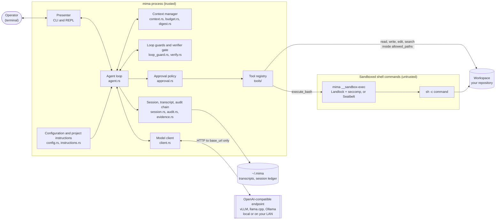
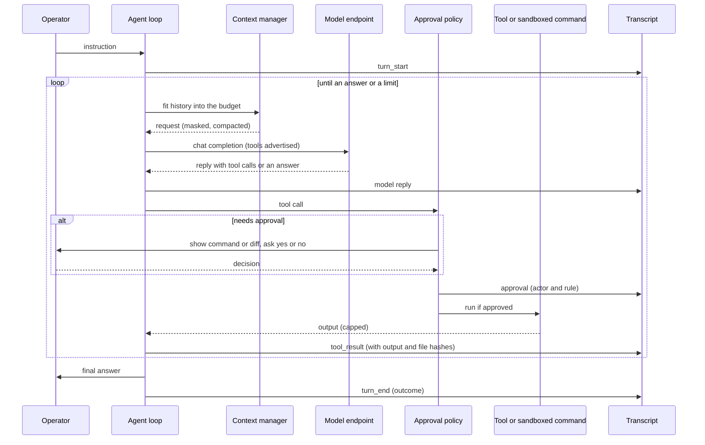
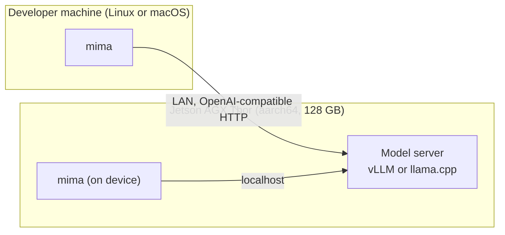

# Architecture

This document is the high-level design of mima (`minister_mandati`): what
it is for, how it is built, where your data goes, and which defaults keep it
safe. Detailed designs live in [design/](design/); the phased roadmap and
status are in [plan.md](plan.md).

## Goals

mima is a coding agent for the terminal, written in Rust, for open-source
and Linux developers. Four goals shape every design decision:

1. **Auditable.** You can check what mima did, and why, after the fact. The
   code is small enough to review. The transcript of a session is a
   hash-chained, attributed record of each request, model reply, decision
   and tool result, and it can be verified offline. Decisions made by code
   rather than by the model name the rule that made them.
2. **Local models without leaking your data.** mima talks to one
   OpenAI-compatible endpoint that you choose, typically an open-weight
   model served by vLLM, llama.cpp or Ollama on your own machine or LAN.
   There is no telemetry, analytics, update check or other built-in network
   destination. With a local endpoint, your code and prompts stay on your
   hardware.
3. **Open source and Linux first.** The shell sandbox uses Linux kernel
   features (Landlock, seccomp). The build is a single Rust binary, with a
   static build option. The edge target is the NVIDIA Jetson AGX Thor, a
   128 GB aarch64 device that can serve and run the model on the same box.
   macOS is supported (Seatbelt sandbox); Windows is not.
4. **Convention over configuration, with secure conventions.** mima runs
   with no configuration file. Every default is chosen to be safe: risky
   capabilities are off until you turn them on, and a repository you open
   cannot turn them on for you.

Two further principles follow from these: the loop stays flat and simple
(one model, one conversation, no hidden sub-agents), and every change in
agent behavior is measured with the evaluation harness before it becomes a
default ([eval.md](eval.md)).

## System overview

Read it from the operator outward:

- The **presenter** is the only part that touches the terminal. The core
  emits typed events (tool requested, output, approval needed, answer) and
  asks the presenter for decisions, so other front ends can be added without
  changing the loop ([../rust_terminal_agent_plan.md](../rust_terminal_agent_plan.md),
  "Presentation Decoupling").
- The **agent loop** runs one turn from instruction to final answer: fit the
  context into the budget, call the model, run the tool calls it asks for,
  append the results, repeat until the model answers or a limit is reached.
- The **context manager** keeps each request inside the model's window:
  it masks old tool output, then replaces evicted steps with a code-built
  digest of what they read, changed and ran ([context.md](context.md)).
- **Loop guards** stop repeated or stalled work, and the optional
  **verifier gate** sends test failures back to the model before an answer
  is accepted ([design/design-loop-guards.md](design/design-loop-guards.md),
  [design/design-verifier-gate.md](design/design-verifier-gate.md)).
- The **approval policy** decides, by fixed rules, which tool calls need
  your yes. The **tool registry** runs them. File tools stay inside
  `allowed_paths`; shell commands run in the sandbox.
- The **model client** sends requests only to the configured `base_url`.
- The **session** writes the optional transcript, with its audit chain, to
  `~/.mima`, outside the workspace and out of reach of sandboxed commands.

## One step of a turn

Records are written before the action they describe when audit mode is
required, so an approval is on disk before its tool runs.

## Components

| Area | Modules | Responsibility | Details |
|---|---|---|---|
| Entry and modes | `main.rs` | One-shot, REPL and piped modes; slash commands; resume; audit verify and export | [../README.md](../README.md) |
| Configuration | `config.rs` | Defaults, discovery, `MIMA_*` overrides, `${ENV}` expansion, trust rules for workspace config | [../agent.toml.example](../agent.toml.example) |
| Agent loop | `agent.rs`, `presenter.rs` | The turn, step limits, time limits, events to the presenter | |
| Model client | `client.rs`, `schema.rs` | OpenAI-compatible chat, streaming, retries, native tool calls with a ReAct fallback, token counts from the server | [cloud-providers.md](cloud-providers.md) |
| Context | `context.rs`, `budget.rs`, `digest.rs`, `context_report.rs` | Window budget, output masking, eviction with a digest record, `/context-status` | [context.md](context.md) |
| Guards and verification | `loop_guard.rs`, `verify.rs` | Duplicate and no-progress detection; completion gate on the project's tests; syntax guard | [design/design-verifier-gate.md](design/design-verifier-gate.md) |
| Project instructions | `instructions.rs` | `AGENTS.md` from the repository root to the working directory, cleaned, capped and labeled | [design/design-project-instructions.md](design/design-project-instructions.md) |
| Tools | `tools/` | `read_file`, `write_file`, `edit_file`, `list_dir`, `find_files`, `search_files`, `execute_bash` | [editing.md](editing.md) |
| Approvals | `approval.rs` | Which calls prompt; the allowlist for sandboxed commands | |
| Shell sandbox | `sandbox.rs`, `sandbox/`, `tools/shell.rs` | Process hygiene (Tier 0); Landlock, seccomp and rlimits on Linux, Seatbelt on macOS (Tier 1) | [design/design-shell-sandboxing.md](design/design-shell-sandboxing.md) |
| Sessions and audit | `session.rs`, `transcript.rs`, `audit.rs`, `evidence.rs` | JSONL transcripts, resume, hash chain, session ledger, attribution, evidence hashes | [sessions.md](sessions.md), [design/design-audit-record.md](design/design-audit-record.md) |
| Evaluation | `src/bin/mima-eval/` | Runs task suites against the real binary in bubblewrap, scores with deterministic checks, reports statistics | [eval.md](eval.md) |

## Where your data goes

mima's own traffic has a single destination, the endpoint in
`[provider].base_url`. All of it goes there: the chat completions, the model
list (`/models`), the server version (`/version`) and, on vLLM, exact token
counts (`/tokenize`).

| Data | Where it goes | Who controls it |
|---|---|---|
| Instructions, file contents and tool output that enter the context | The configured endpoint, in each request | You choose the endpoint. With a local server it never leaves your machine or LAN. With a cloud endpoint (for example Azure OpenAI) it goes to that provider. |
| Transcripts and the session ledger | `~/.mima` on the local disk, only when recording is on | Off by default; `--transcript`, `[session].transcripts` or audit mode turn it on. `--audit-export --withhold` produces a copy to share without the content |
| The API key | Only the `Authorization` header to the endpoint | Never written to transcripts and never passed to shell commands |
| Shell command traffic | Nowhere by default: the sandbox turns the network off | `[security].sandbox_network = true` turns it on |

Shell commands are the other path out, because the model chooses them. The
defaults close that path as far as the kernel allows:
- commands need your approval;
- they run with the network off and an allowlisted environment (no API keys
  or tokens);
- they can't read your home directory beyond toolchain paths, so `~/.ssh`
  and cloud credentials are out of reach.

The remaining gaps are listed under [Known limits](#known-limits).

## Auditability

- **Transcript as the record.** Each session can write an append-only JSON
  Lines transcript ([sessions.md](sessions.md)). The same file drives
  `--resume` and the evaluation metrics, so there is one account of what
  happened, not several.
- **Tamper evidence.** Every record carries the SHA-256 of the previous
  record's hash and its own bytes. The session ledger keeps each session's
  head hash, and `mima --audit-verify` checks a transcript offline, against
  the ledger or against a head you kept elsewhere.
- **Complete header.** The first record names the build, the binary's hash,
  the configuration's source and effective values (including what a
  workspace config tried and failed to set), the full system prompt, the
  tool specifications, sampling settings, the server's model, the sandbox
  state and the workspace's git state.
- **Attribution.** Every record says which actor caused it (operator,
  model, rule, tool, system). Every deterministic decision names its rule
  (for example `approval.auto_approve_bash` or `verify.gate`), so a person's
  yes, an allowlist match and `--approve-all` are told apart.
- **Evidence.** Hashes of full tool outputs (also when the stored copy is
  cut), of files before and after each change, of each request sent to the
  model, and of files changed by shell commands.
- **Required mode.** With `--audit` (or `[audit].required`), recording
  cannot be turned off, each record is on disk before its action, and a
  recording failure stops mima.
- **Determinism where possible.** Guards, compaction, approvals and the
  verifier gate are code with fixed rules, recorded as such. The model is
  the only nondeterministic actor, and its part is labeled.

## Convention over configuration, with secure defaults

mima needs no configuration file. Without one it talks to a local Ollama-style
endpoint at `http://localhost:11434/v1`. `MIMA_BASE_URL`, `MIMA_MODEL` and
`MIMA_API_KEY` override the endpoint; an `agent.toml` sets everything else.
The configuration is read from `./agent.toml`, then from
`~/.config/minister_mandati/agent.toml`. Every setting is listed with its
default in [../agent.toml.example](../agent.toml.example).

The conventions are chosen so that the default is the safe choice:

| Concern | Convention (default) | To change it |
|---|---|---|
| Shell commands | Ask before each one | `[security].auto_approve_bash` (exact prefixes, sandboxed commands only) |
| File writes and edits | Ask, with a diff | `[security].require_approval_for_writes` |
| Read-only tools | Never ask; confined to `allowed_paths` | `[security].allowed_paths` |
| Shell sandbox | On where the kernel supports it (`auto`) | `[security].sandbox = "required"` or `"off"` |
| Network for commands | Off | `[security].sandbox_network` |
| GPU (CUDA) for commands | Off; never granted to root | `[security].sandbox_gpu` |
| Readable home paths for commands | Toolchains and git config only | `[security].sandbox_read_paths` |
| Writable paths for commands | Workspace and a private temp directory | `[security].sandbox_writable_paths` |
| Environment of commands | An allowlist; never API keys or `*_TOKEN` | `[security].env_passthrough` |
| Transcripts | Off (nothing is stored unless you ask) | `--transcript`, `[session].transcripts`, `--audit` |
| Telemetry | None, and no setting for it | |
| Context window | Taken from the server | `[context].window` |
| Self-refinement (verifier gate) | Off | `[verify].enabled` |
| Project instructions | `AGENTS.md` files loaded, labeled as project content | `--no-project-instructions`, `[instructions]` |

**Your config versus the repository's config.** An `agent.toml` in the
working directory belongs to the repository, and a repository may be
untrusted. Such a file can make mima stricter, never looser:
- it cannot remove approvals or add allowlist entries;
- it cannot turn the sandbox off, or widen its paths, network or GPU access;
- it cannot replace the system prompt, or turn on the verifier gate, which
  would run the repository's commands;
- it can turn audit mode on, never off.

Every setting it tried and failed to change is logged at startup and kept
in the audit header. Writes to `agent.toml` and `AGENTS.md` always ask,
whatever the allowlist says.

## Trust model

| Party | Trusted? | How mima treats it |
|---|---|---|
| Operator at the terminal | Yes | Gives instructions, answers approvals |
| User configuration (`~/.config/minister_mandati/`) | Yes | May widen any setting |
| The model | No | Its tool calls go through the approval policy and the sandbox; its arguments are checked against the tool schemas |
| The workspace, including its `agent.toml` and `AGENTS.md` | No | Config can only narrow; instructions are cleaned, capped and marked as project content, not operator instructions |
| Shell commands | No | Sandboxed: filesystem, network and system calls restricted; ended with their process group |

The sandbox protects everything outside the workspace. It does not protect
the workspace from the agent: that is what approvals, the diff preview and
the transcript are for.

## Deployment

- **LAN model server.** mima runs on your workstation; the Thor serves the
  model. This is the setup the evaluations use.
- **All on one device.** mima and the model run on the Thor. mima builds
  and its full test suite passes natively on aarch64, including the sandbox
  matrix on Landlock ABI 4. The static aarch64 release build is still
  planned ([plan.md](plan.md), Phase 6).
- **Cloud endpoint.** Supported for comparison and manual testing
  ([cloud-providers.md](cloud-providers.md)); your context then goes to that
  provider.

## Known limits

Stated plainly, so that the claims above are not read as stronger than they
are:

- **A cloud endpoint means your context leaves the machine.** The no-leak
  property holds for a local or LAN endpoint you control.
- **Sandbox gaps on older kernels.** Below Landlock ABI 6 (the Thor has ABI
  4), sandboxed commands can still send signals to your other processes.
- **Datagrams through `sendmsg`.** With the network off, a sandboxed command
  can still send datagrams to a local daemon's Unix socket (such as
  `/dev/log`) through `sendmsg`, because seccomp cannot read the address.
  Plain `sendto` with an address is refused.
- **Workspace changes.** Approved commands and edits can change anything in
  the workspace, including `.git/hooks`; the planned integrity check (S2) is
  not done yet.
- **Background processes.** A command can start a process in a new session
  that outlives it; it stays sandboxed. Ending such processes needs the
  planned Tier 3 (a systemd scope).
- **Not yet built.** MCP and web tools are proposals only. Prompt-injection
  red-team evaluation and taint tracking come first, because both features
  add untrusted content and an outbound channel ([plan.md](plan.md), Phase 3
  ordering).

The sandbox's full list of gaps and test results is in
[design/design-shell-sandboxing.md](design/design-shell-sandboxing.md).

## Related documents

- [../README.md](../README.md): installation and usage.
- [../rust_terminal_agent_plan.md](../rust_terminal_agent_plan.md): the
  original technical specification and Phase 0 design decisions.
- [requirements.md](requirements.md): Linux and kernel domain requirements.
- [plan.md](plan.md): phases, status and the work queue.
- [design/](design/): one document per subsystem.
